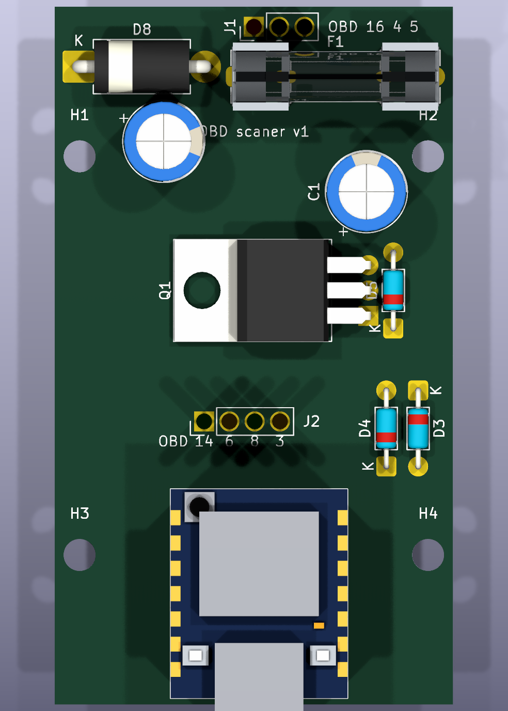
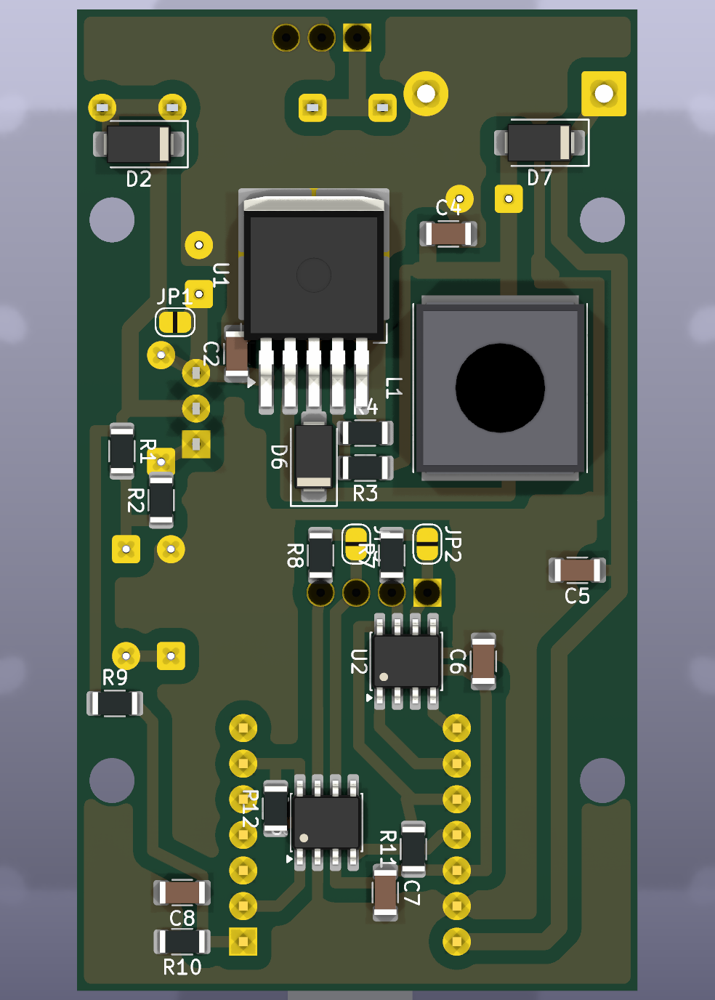

# Board v1

[Русская версия](../ПЛАТА_v1.md)

**Goal:** the first complete board of my own, fitted inside an OBD2 enclosure with a built-in connector. Plug it into the C3, read legislated OBD-II on channel A and identify the BSI over Diag-on-CAN on channel B.

Components: [XIAO ESP32-C5 board](xiao-esp32c5.md), [SN65HVD230 transceiver](can-sn65hvd230.md), [LM2596 DC-DC](dc-dc-5v.md), [input protection](power-protection.md). KiCad project: [hardware/scaner_v1](../../hardware/scaner_v1/).


## Block diagram

```text
OBD 16 ─► fuse ─► HS1M ─► IRFB4110 source follower (≤ 27 V) ─► LM2596S-ADJ (4.9 V) ─► SS34 ─► 5V (TVS 1.5KE6.8CA) ─► XIAO ESP32-C5 (LDO) ─► 3.3 V ─► transceiver VCC
OBD 6/14 ─► SN65HVD230 (A) ◄─► D8 (GPIO8) D, D7 (GPIO12) R, D9 (GPIO9) Rs
OBD 3/8  ─► SN65HVD230 (B) ◄─► D1 (GPIO0) D, D10 (GPIO10) R, D5 (GPIO24) Rs
OBD 4, 5 ─► GND
```

The SN65HVD230 chips are desoldered from Waveshare modules and mounted directly on the board. The XIAO sits on female headers (the module ends up ~10 mm above the board); if the enclosure is too low, it can be soldered directly. Input protection and the DC-DC converter are built on the board.

## Enclosure and dimensions

OBD2 enclosure with a built-in connector (AliExpress, ~10 €). From the seller's photos: 72 × 45 mm outside, 42 mm wide inside, four screw posts 35 × 40 mm apart (centre to centre).

- Board 40 × 70 mm, four M3 holes on the posts: 35 mm across, 40 mm along. For now they are centred along the length — to be checked on the real enclosure (distance from the connector end to the first pair of posts).
- Single-sided board, same style as my lab PSU: bottom copper carries the etched tracks, the top side would only carry wire jumpers (this board needs none).
- Short wires run from the connector pins to the pads (only pins 3, 4, 5, 6, 8, 14, 16 are used). Power (16, 4, 5) goes to J1 next to the fuse, and both CAN pairs go to J2 next to the transceivers: 14, 6, 8, 3 (4–5 cm wires, twist the pairs). This avoids a four-track bus across the whole board.
- The IRFB4110 (TO-220) lies tab-down over the LM2596, no screw. The 1.5KE TVS (DO-201AD, 12.7 mm pitch) and the glass zeners (DO-35, 7.62 mm pitch) lie flat. The 8 mm electrolytics stand upright: they are no taller than the XIAO on its sockets (~13 mm).
- The XIAO's USB connector faces the far end of the enclosure, so a window can be cut there to flash it without opening the case.

> ⚠ Dimensions come from the seller's photos. When the enclosure arrives, measure the inside length from the connector to the far end, the post positions relative to the connector, and the inside height. The outline and holes will be adjusted to match.

## OBD-II connector

| OBD pin | Signal | Pad |
| --- | --- | --- |
| 16 | +12 V from the battery (always present, even with ignition off) | J1.1 |
| 4 | chassis ground | J1.2 |
| 5 | signal ground | J1.3 |
| 14 | CAN-L, legislated OBD-II (channel A) | J2.1 |
| 6 | CAN-H, legislated OBD-II (channel A) | J2.2 |
| 8 | Diag CAN-L, PSA (channel B) | J2.3 |
| 3 | Diag CAN-H, PSA (channel B) | J2.4 |

The silkscreen shows "OBD 16 4 5" next to J1 (left to right) and the OBD pin number under every J2 pad: 14, 6, 8, 3.

The other pins are not connected. Check every wire with a meter after soldering: the plug's pin numbering is mirrored compared with the car socket.

## Power

OBD 16 → 1 A fuse (5×20 glass in clips) → HS1M → IRFB4110 source follower (output limited to ~27 V) → 100 µF / 50 V → LM2596S-ADJ (4.9 V) → SS34 → 5V rail (with a 1.5KE6.8CA TVS) → XIAO ESP32-C5. Its regulator supplies 3.3 V, which also powers the transceivers. Details: [power protection](power-protection.md) and [DC-DC](dc-dc-5v.md).

**The SS34 after the DC-DC** isolates it from USB. The 5V rail sits at ~4.6 V, slightly below USB: with a laptop plugged in, the board runs from USB and nothing is pushed into the laptop.

**Option on the board:** solder jumper JP1 — close it if the source follower is not fitted. v1 has no footprint for a 1.5KE27A input TVS: the IRFB4110 follower already handles the input (up to 100 V).

## Battery voltage

```text
after HS1M ──[220 kΩ]──┬──► D0 (ADC)
                       ├──[33 kΩ]──► GND
                       └──[100 nF]──► GND
```

The divider sits before the limiter so it measures the real battery voltage. At the ADC input: 12 V → ~1.4 V, 14.4 V → ~1.7 V, 18 V → ~2.2 V. The HS1M drop (~1 V) is compensated in firmware. Close to 0 V on D0 means there is no car and the board is powered from USB.

## XIAO ESP32-C5 pins

| Signal | Pin |
| --- | --- |
| CAN-A: D / R / Rs | D8 (GPIO8) / D7 (GPIO12) / D9 (GPIO9) |
| CAN-B: D / R / Rs | D1 (GPIO0) / D10 (GPIO10) / D5 (GPIO24) |
| Battery voltage | D0 (GPIO1, ADC) |
| LED | GPIO27 (on the XIAO) |
| Free | D4 (GPIO23) |
| Not used | D2 (GPIO25) and D3 (GPIO7) — strapping pins; D6 (GPIO11, boot log output) |

The pins were chosen for single-sided routing. D7 is UART0 RX, but the console runs over USB, so UART0 is free. Transceiver wiring, pull-ups and terminators are described in [SN65HVD230](can-sn65hvd230.md).

## Layout

Single-sided board, all tracks on the bottom, **no wire jumpers**. Ground is a solid bottom pour connected to the pads without thermal reliefs, kept 1 mm away from other copper and never narrower than 1 mm.


- Tracks: 0.8 mm signals, 1.2 mm power, 1.0 mm for the switching node. 0.4 mm clearance. Transceiver supply and ground run under the SOIC-8 body between the two rows of pins (0.8 mm).
- SN65HVD230 pads are 0.8 mm wide, like the tracks to them (~0.47 mm between neighbouring pads).
- Pads of through-hole parts and of the XIAO sockets are 2.0 mm. All lead holes are 0.6 mm pilot holes, drilled out to the lead size afterwards. Mounting holes are 3.2 mm for M3.
- 12×12 inductor: a custom footprint matching the real part — two 5.6 × 11.2 mm pads with a 2 mm gap, extending 0.6 mm beyond the body (tracks connect there and that is where the iron goes). No copper at all under the inductor body (keep-out zone).
- The power ground (LM2596, input) and the transceiver/XIAO ground are tied by a 0.8 mm ground track: between the D7 pads (shortened to 2 mm, leaving 2.5 mm between them), down the left side past the inductor, and along a strip under the switching-node track to the D3/D4 zeners — the 1 mm pour cannot fit through those places.
- The channel B transceiver (U3) sits on the bottom side under the XIAO, between the socket rows. Nothing is mounted on top there.
- Placement is `tools/gen_pcb.py`, the tracks are point lists in `tools/routes.py`, and `tools/hand_route.py` lays them down, pours ground and runs DRC. Order: `gen_schematic.py` → `check_netlist.py` → `gen_pcb.py` → `hand_route.py`.
- 3D: everything missing from the KiCad library (XIAO on sockets, 12×12 inductor, 5×20 fuse holder with fuse, OBD wires on J1/J2) is drawn by `tools/gen_3d.py` into `scaner.3dshapes/`. View it with Alt+3 in KiCad or with `kicad-cli pcb render`.

| Top | Bottom |
| --- | --- |
|  |  |

## Channel B terminator: decided by measurement

Ignition off, car locked and asleep (5–10 minutes). Multimeter on resistance, probes in the car's OBD socket:

| Pins | Expected | Meaning |
| --- | --- | --- |
| 6–14 | ~60 Ω | both bus terminators present, ours is not needed |
| 3–8 | ~60 or ~120 Ω | 60 → ours not needed; 120 → the BSI expects the tool to terminate the line, close JP3 |

Measurements:

- 6–14: ____ Ω
- 3–8: ____ Ω

## Bench test without a car

An STM32 with built-in CAN and a complete third Waveshare module (keep its R2 terminator) plays the car. Wire it to channel A or B of our board and close that channel's terminator jumper: the bus then has both ends terminated, 60 Ω. A bench is optional: the A↔B self-test plus the car itself are enough.

## First power-up

1. **Power without the XIAO.** Feed 12 V from a current-limited bench supply. Check ~4.9 V at the LM2596 output and ~4.6 V on the 5V rail. Then slowly raise the input to 35–40 V: the follower output must stay at ~27 V or below, and the transistor only warm.
2. **USB self-test, no car.** Connect channels A and B together (CANH–CANH, CANL–CANL) and close both terminators. The self-test firmware exchanges frames between the channels.
3. **Terminator measurement on the car** (see above).
4. **In the car, listen-only.** Ignition on. The Rs pins stay high (pull-ups), so the transceivers physically cannot transmit, and the CAN controllers are in listen-only mode as well. Watch the traffic on both channels.
5. **First requests.** Standard OBD-II on channel A: rpm, coolant temperature and VIN if the car provides it. BSI identification (`752:652`) on channel B.

## Not done yet

- Nothing is written to the ECUs: the app only reads; the only write is clearing fault codes.
- The adapter is not left in the car overnight until there is a sleep mode.
