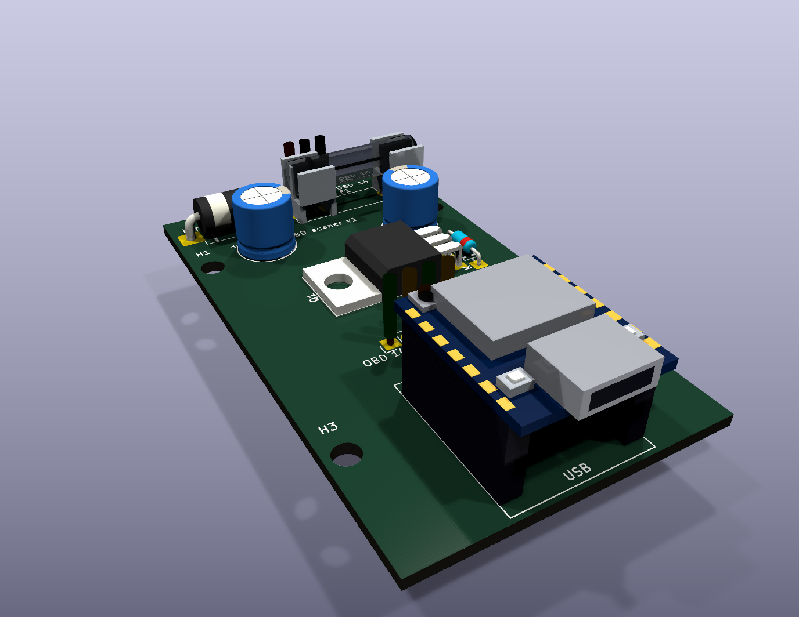

# Сканер-адаптер OBD на ESP32-C5

[English version](README.md)

Самодельный диагностический адаптер OBD2 на Seeed XIAO ESP32-C5 с двумя каналами CAN и приложение для Android, которое только читает. Первая цель — моя Citroën C3 II (2011, 1.4 KFT): список блоков, ошибки (чтение и сброс), живые данные, стоп-кадры, монитор шины и отчёт в PDF. Другие машины добавляются через базу знаний в JSON, без переделки прошивки.

> **Состояние:** схема и односторонняя плата готовы — плата разведена на одном слое меди **без перемычек**. Приложение работает с симулятором на Python и проверено на телефоне. Плата ещё не травилась и не собиралась: все цифры по железу ниже — расчёт, а не замеры.

## Решения

| Что | Решение | Почему |
| --- | --- | --- |
| Мозг | Seeed XIAO ESP32-C5 | 2 контроллера CAN (TWAI), оба с CAN-FD; Wi-Fi 6 на 2,4 и 5 ГГц; BLE; 8 МБ PSRAM |
| Канал CAN A | OBD 6/14 | стандартный OBD-II (двигатель) |
| Канал CAN B | OBD 3/8 | PSA Diag-on-CAN через BSI, доступ ко всем блокам |
| Трансиверы | 2 × SN65HVD230 (SOIC-8), выпаянные с модулей Waveshare | 3,3 В, для C3 хватает; Rs на D9/D5 с подтяжкой — аппаратный «только слушать». CAN-FD — в v2 |
| Питание | OBD 16 → предохранитель → HS1M → повторитель на IRFB4110 (≤ 27 В) → LM2596S-ADJ (4,9 В) → SS34 (+ TVS 1.5KE6.8CA) → LDO 3,3 В на плате XIAO | всё из запасов; переживает прикуривание от 24 В и выбросы до 100 В |
| Исполнение | своя односторонняя плата 40 × 70 мм внутри корпуса OBD2 со встроенным разъёмом; дорожки только снизу, перемычек нет | один брелок, никаких кабелей |
| Приложение | Flutter для Android (Galaxy A55): только чтение и сброс ошибок; две темы; русский и английский | |
| Связь | Wi-Fi, JSON по WebSocket; адаптер — «тупой» транспорт, вся логика в приложении | новая машина = новый JSON-файл |

## Что где

| Папка | Что там |
| --- | --- |
| [`hardware/scaner_v1/`](hardware/scaner_v1/README.ru.md) | проект KiCad 10: схема, плата, посадочные места, 3D-модели и скрипты на Python, которые генерируют и разводят плату; PDF в `build/` |
| [`firmware/scaner_fw/`](firmware/scaner_fw/README.ru.md) | прошивка самотеста платы на ESP-IDF 6.1 (оба канала CAN, «только слушать», напряжение АКБ) |
| [`app/`](app/README.ru.md) | приложение на Flutter |
| [`sim/`](sim/README.ru.md) | симулятор адаптера с подключённой C3 на Python — писать приложение без железа и без машины |
| [`DOCS/`](DOCS/) | документация на русском ([`DOCS/en/`](DOCS/en/) — на английском) |

## Документация

- [Плата v1](DOCS/ПЛАТА_v1.md): блок-схема, корпус, провода от разъёма OBD, назначение выводов, разводка, первый запуск
- [Защита питания](DOCS/ЗАЩИТА_ПИТАНИЯ.md): что бывает в бортсети и как плата это переживает
- [DC-DC на LM2596S-ADJ](DOCS/DC-DC_5V.md): обвязка и номиналы
- [Плата XIAO ESP32-C5](DOCS/ESP32-C5_ПЛАТА.md): распиновка и какие выводы заняты
- [Трансивер SN65HVD230](DOCS/CAN_SN65HVD230.md): подключение, режим «только слушать», терминаторы
- [Протокол адаптер ↔ приложение](DOCS/ПРОТОКОЛ.md)
- [Список покупок](DOCS/ПОКУПКИ.md)

PDF: [схема](hardware/scaner_v1/build/scaner_v1.pdf), [расстановка и медь](hardware/scaner_v1/build/pcb_placement.pdf), [нижняя медь 1:1 для травления](hardware/scaner_v1/build/pcb_bottom_cu.pdf).

## Что известно про C3 (PSA, архитектура AEE2004/2010)

- Полная диагностика идёт по пинам **3/8** (Diag-on-CAN, 500 кбит/с) через BSI. По **6/14** доступен только стандартный OBD-II двигателя.
- Протоколы: KWP2000 и UDS поверх CAN (ISO-TP).
- Адреса блоков (запрос:ответ): BSI `752:652`, двигатель `6A8:688`, ABS/ESP `6AD:68D`, подушки `744:644`, приборка `75F:65F`.
- Какой стоит блок двигателя, пока неизвестно — покажет сканер.

## Правила

1. Приложение только читает. Из записи — только сброс ошибок.
2. Подушки и ABS — только чтение. Экологию не трогаем.
3. Адаптер не оставляем в машине: на пине 16 питание от АКБ есть всегда.

## Благодарности и сторонние проекты

Чужой код в репозиторий не копировался. Использовали или опирались на:

- [ludwig-v/arduino-psa-diag](https://github.com/ludwig-v/arduino-psa-diag) — адреса блоков PSA ([ECU_LIST.md](https://github.com/ludwig-v/arduino-psa-diag/blob/master/ECU_LIST.md)).
- [KiCad](https://www.kicad.org/) и его официальные библиотеки символов, посадочных мест и 3D-моделей.
- [Freerouting](https://github.com/freerouting/freerouting) — пробовали автороутер для оценки разводки (`hardware/scaner_v1/tools/route.py`); итоговая разводка ручная.
- [ESP-IDF](https://github.com/espressif/esp-idf) (Espressif) — основа прошивки; [вики Seeed Studio](https://wiki.seeedstudio.com/xiao_esp32c5_getting_started/) — распиновка XIAO ESP32-C5.
- [Flutter](https://flutter.dev/) и пакеты Dart из [`app/pubspec.yaml`](app/pubspec.yaml): web_socket_channel, flutter_svg, google_fonts, shared_preferences, intl, image_picker, path_provider, pdf, share_plus.
- Шрифты [Exo 2](https://fonts.google.com/specimen/Exo+2) и [IBM Plex](https://github.com/IBM/plex), лицензия SIL Open Font License 1.1 (тексты лицензий в `app/assets/google_fonts/`).
- [websockets](https://github.com/python-websockets/websockets) — сервер WebSocket в симуляторе.
- Даташиты: Texas Instruments (SN65HVD230, LM2596), Espressif (ESP32-C5), Waveshare (схема SN65HVD230 CAN Board).

У каждого из них своя лицензия.

## Лицензия

См. [NOTICE.md](NOTICE.md) и [LICENSE](LICENSE) (CC BY-NC-ND 4.0, собрать одну штуку для себя — можно).
