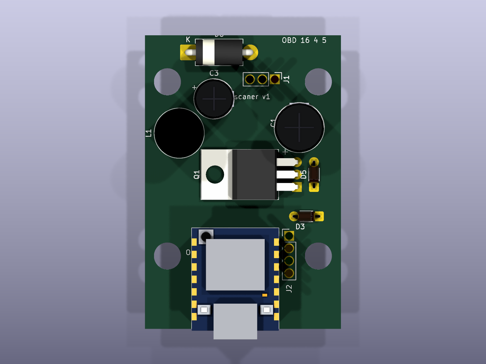
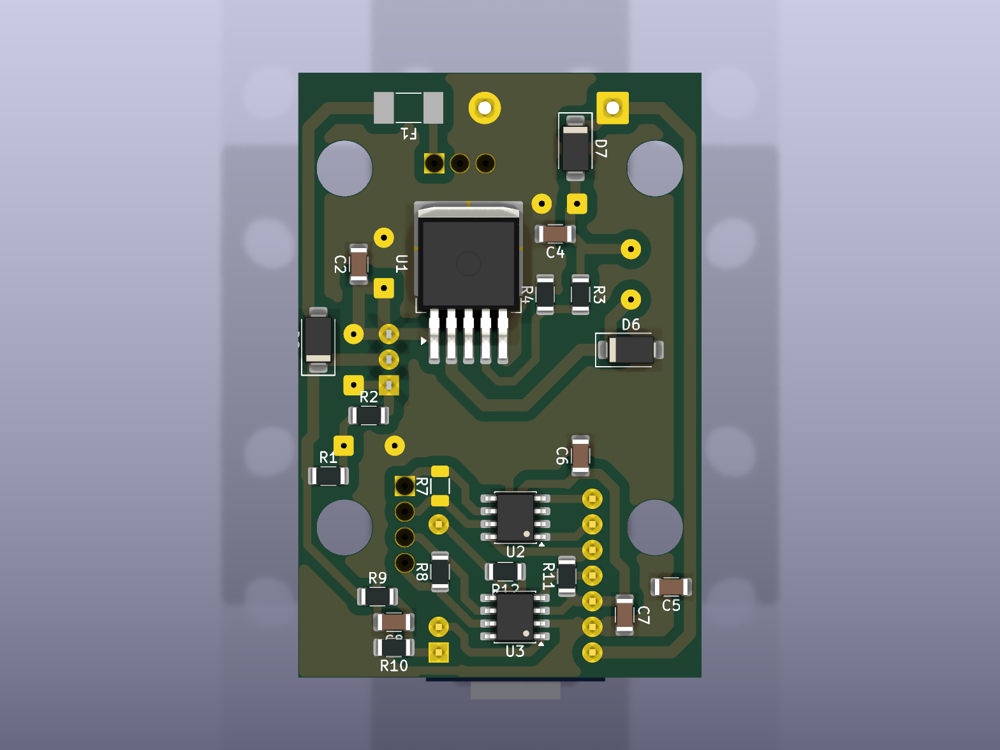
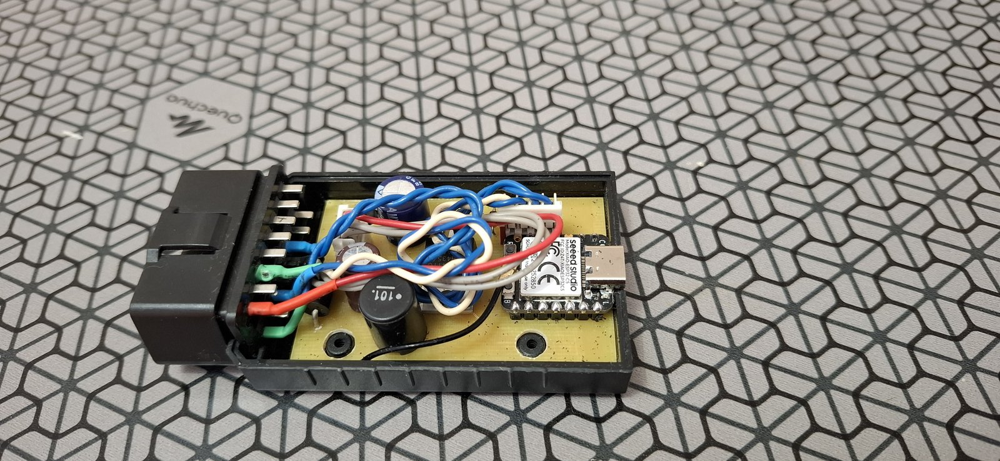
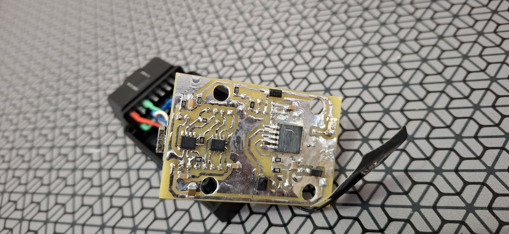

# Board v1 — KiCad project

[Русская версия](README.ru.md)

KiCad 10 project of the adapter board: 40 × 60 mm, single-sided (all tracks on the bottom copper, no wire jumpers), designed for home etching and built into an OBD2 enclosure. Description and design notes: [DOCS/en/board-v1.md](../../DOCS/en/board-v1.md).

| Top | Bottom |
| --- | --- |
|  |  |
|  |  |

Top row: KiCad 3D. Bottom row: the board as built, in its enclosure and from the copper side.

## Files

| Path | Contents |
| --- | --- |
| `scaner_v1.kicad_sch`, `scaner_v1.kicad_pcb`, `scaner_v1.kicad_pro` | schematic, board, project (design rules: 0.8 mm tracks, 0.4 mm clearance) |
| `scaner.pretty/` | project footprints: XIAO ESP32-C5 on two 1×7 sockets, DO-35 zener at 5.08 mm pitch, OBD2 enclosure outline |
| `scaner.3dshapes/` | hand-written 3D models (VRML) for parts missing from the KiCad library |
| `build/*.pdf` | schematic, placement with copper, bottom copper 1:1 for etching |
| `tools/` | Python scripts that generate everything (see below) |

## The board is generated, not drawn by hand

The schematic, placement and routing are produced by scripts, so a change is made in the script and everything is regenerated:

```sh
python tools/gen_schematic.py        # parts, nets, project footprints -> scaner_v1.kicad_sch
python tools/check_netlist.py        # ERC and netlist check against tools/expected_nets.json
"C:\Program Files\KiCad\10.0\bin\python.exe" tools/gen_pcb.py       # placement (PLACE table), pad rules, keep-outs
"C:\Program Files\KiCad\10.0\bin\python.exe" tools/hand_route.py    # tracks from tools/routes.py, ground pour, DRC
python tools/gen_3d.py               # 3D models into scaner.3dshapes/
```

- `routes.py` — every track as a list of points (or `REF.pad` references) with its width.
- `view_board.py` — an SVG view of the board with net names on the pads, ratsnest and DRC markers; handy while routing.
- `route.py` — Freerouting experiment kept for reference; it overwrites the hand routing.

Manual edits made in KiCad are overwritten by the next `gen_pcb.py` / `hand_route.py` run — carry them over into `routes.py` first.

**The 40 × 60 mm board for the enclosure was placed and routed by hand in KiCad** (October 2026), then etched and assembled. Do not run `gen_pcb.py` or `hand_route.py`: they bring back the old 40 × 70 board and overwrite the manual work; `routes.py` is the old routing, kept for reference. Values in the schematic and on the board match what is soldered: R1 51k, R9 200k, R11 12k, R8 fitted, R7 left out.

## Printing for etching

KiCad's Print dialog is awkward for photoresist work, so there is a print window of its own — the
"Печать для травления" button in the PCB editor (or `tools/etch_window.cmd` without KiCad):

```sh
"C:\Program Files\KiCad\10.0\bin\python.exe" tools/etch_window.py --pack      # tools/etch_print_kicad_plugin.zip for KiCad's Plugin and Content Manager
"C:\Program Files\KiCad\10.0\bin\python.exe" tools/etch_window.py --install   # while editing the code: button loaded straight from the repo (silent if the package is installed)
"C:\Program Files\KiCad\10.0\bin\python.exe" tools/etch_print.py              # no window: 4 PDFs in etch/ with an automatic layout
```

To get the button: KiCad → Plugin and Content Manager → Install from File… → `tools/etch_print_kicad_plugin.zip`.
The package lives in `Documents\KiCad\<version>\3rdparty` and survives a KiCad reinstall; after a new KiCad
version install the zip again. After changing the code, run `--pack` and reinstall the package.

- Settings on the left (scrollable), the sheet on the right; drag the divider between them.
- An A4 sheet like a print preview: drag board copies with the mouse (arrow keys move 0.5 mm), "+ copy",
  "fill the sheet"; a red frame marks copies that overlap or leave the printer's printable area.
- Negative (dry-film resist: clear = copper stays) or positive (toner transfer); "toner down / up" sets the
  mirroring: the bottom layer laid toner-to-copper prints unmirrored (KiCad shows it from the top, through the board).
- Prints straight to the printer at 1:1, no PDF viewer involved. "Film: maximum" stores a printer profile with
  the transparency media type, best quality and toner saving off; "Driver settings…" stores any driver settings
  (`%APPDATA%\etch_print`). Toner density on the HP M1530 is set in the printer's own menu.
- On the sheet: 100 mm rulers on both axes to check the scale, drill dots, crosses at mounting-hole centres,
  corner marks at the board edges. Zones are refilled before printing; the layout is kept in `etch/layout.json`.

## Enclosure

The OBD2 enclosure (72 × 46 × 26, AliExpress) is modelled from measurements by a FreeCAD script:

```sh
"C:\Program Files\FreeCAD 1.0\bin\python.exe" tools/gen_case.py      # model, drawings, enclosure layer for KiCad
"C:\Program Files\KiCad\10.0\bin\python.exe" tools/render_case.py   # pictures of the enclosure and the board inside
```

- `case/case_drawing.pdf` — dimensioned drawings (base, lid, sections, details); `*` marks assumed values.
- `case/*.step`, `case/case.FCStd` — 3D model for FreeCAD and other tools.
- `scaner.pretty/Case_OBD2_72x46` — a board-only, locked "enclosure" footprint (CASE1): the "Корпус внутри" layer
  (Eco1) shows walls, posts, plug pins and heights; "Корпус снаружи" (Eco2) the outside; a dashed outline on
  User.Drawings marks the 40 × 60 board. In the 3D viewer the enclosure is translucent, board bottom 5 mm above the floor.
