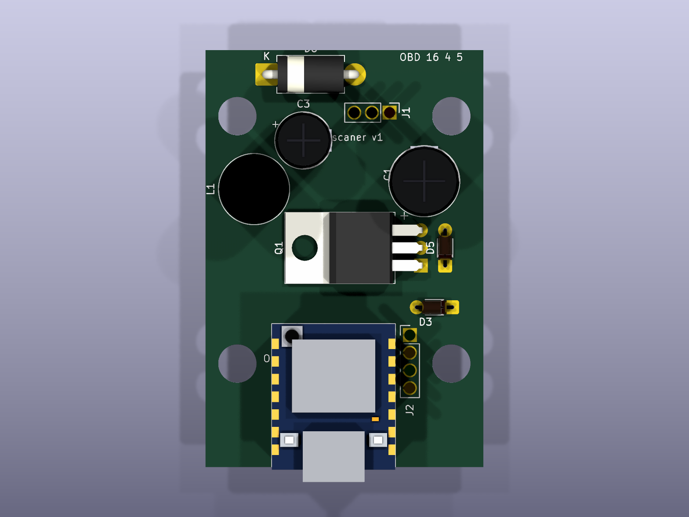
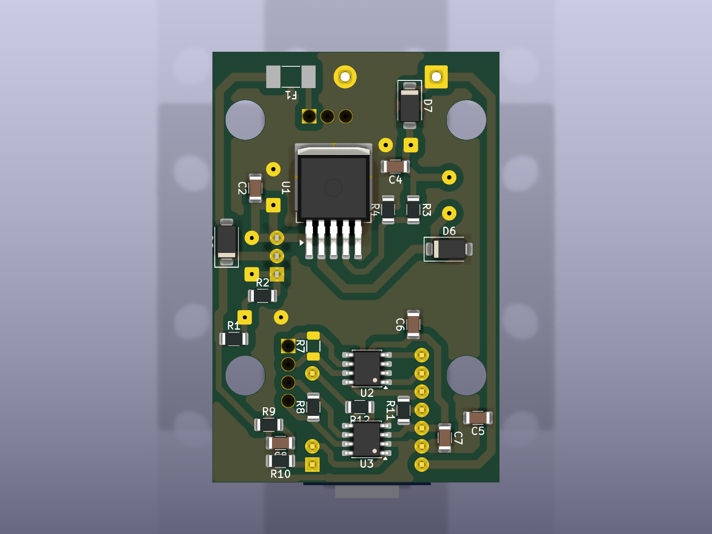
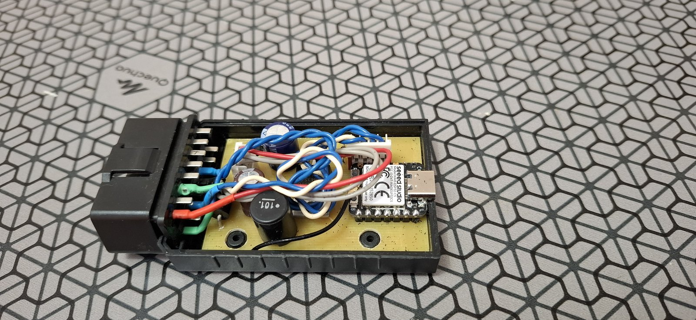
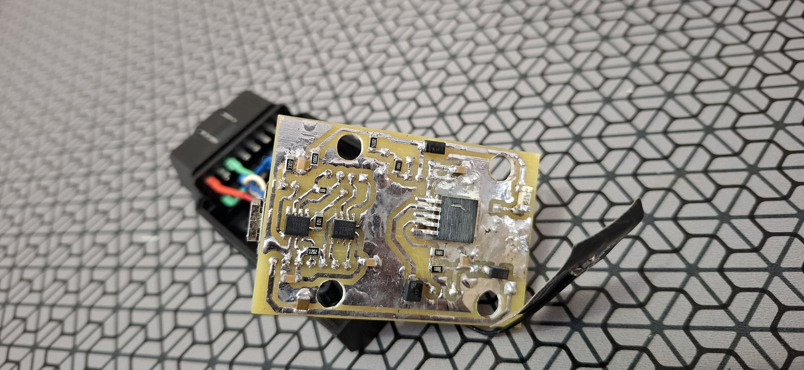

# Плата v1 — проект KiCad

[English version](README.md)

Проект платы адаптера в KiCad 10: 40 × 60 мм, односторонняя (все дорожки на нижней меди, перемычек нет), под домашнее травление, стоит в корпусе OBD2. Описание и решения: [DOCS/ПЛАТА_v1.md](../../DOCS/ПЛАТА_v1.md).

| Сверху | Снизу |
| --- | --- |
|  |  |
|  |  |

Сверху — 3D из KiCad, снизу — настоящая плата: в корпусе и со стороны меди.

## Файлы

| Путь | Что там |
| --- | --- |
| `scaner_v1.kicad_sch`, `scaner_v1.kicad_pcb`, `scaner_v1.kicad_pro` | схема, плата, проект (правила: дорожка 0,8 мм, зазор 0,4 мм) |
| `scaner.pretty/` | свои посадочные места: XIAO ESP32-C5 на двух гнёздах 1×7, стабилитрон DO-35 с шагом 5,08, контур корпуса OBD2 |
| `scaner.3dshapes/` | свои 3D-модели (VRML) для деталей, которых нет в библиотеке KiCad |
| `build/*.pdf` | схема, расстановка с медью, нижняя медь 1:1 для травления |
| `tools/` | скрипты на Python, которые всё генерируют (см. ниже) |

## Плата генерируется, а не рисуется руками

Схема, расстановка и разводка получаются скриптами: правка вносится в скрипт, и всё пересобирается:

```sh
python tools/gen_schematic.py        # детали, цепи, свои посадочные места -> scaner_v1.kicad_sch
python tools/check_netlist.py        # ERC и сверка нетлиста с tools/expected_nets.json
"C:\Program Files\KiCad\10.0\bin\python.exe" tools/gen_pcb.py       # расстановка (таблица PLACE), правила площадок, запреты
"C:\Program Files\KiCad\10.0\bin\python.exe" tools/hand_route.py    # дорожки из tools/routes.py, заливка земли, DRC
python tools/gen_3d.py               # 3D-модели в scaner.3dshapes/
```

- `routes.py` — каждая дорожка списком точек (или ссылок `ДЕТАЛЬ.площадка`) с шириной.
- `view_board.py` — картинка платы в SVG: цепи на площадках, связи, отметки DRC; удобно при разводке.
- `route.py` — опыт с автороутером Freerouting, оставлен для справки; ручную разводку он затирает.

Ручные правки в KiCad затираются следующим запуском `gen_pcb.py` / `hand_route.py` — сначала перенеси их в `routes.py`.

**Плата 40 × 60 мм под корпус расставлена и разведена руками в KiCad** (октябрь 2026), вытравлена и собрана. `gen_pcb.py` и `hand_route.py` не запускать: они вернут старую плату 40 × 70 и затрут ручную работу; `routes.py` — старая разводка, для справки. Номиналы в схеме и на плате — как впаяно: R1 51k, R9 200k, R11 12k, R8 стоит, R7 нет.

## Печать для травления

Окно «Печать» KiCad для фоторезиста неудобно, поэтому есть своё окно печати — кнопка «Печать для травления»
в редакторе плат (или `tools/etch_window.cmd` без KiCad):

```sh
"C:\Program Files\KiCad\10.0\bin\python.exe" tools/etch_window.py --pack      # пакет tools/etch_print_kicad_plugin.zip для менеджера плагинов KiCad
"C:\Program Files\KiCad\10.0\bin\python.exe" tools/etch_window.py --install   # для правки кода: кнопка прямо из репозитория (молчит, если пакет стоит)
"C:\Program Files\KiCad\10.0\bin\python.exe" tools/etch_print.py              # без окна: 4 PDF в etch/ с автоматической раскладкой
```

Поставить кнопку: KiCad → «Менеджер плагинов и библиотек» → «Установить из файла…» →
`tools/etch_print_kicad_plugin.zip`. Пакет живёт в `Документы\KiCad\<версия>\3rdparty` и переживает
переустановку KiCad; после новой версии KiCad — поставить zip ещё раз. После правки кода — `--pack` и
переустановить пакет.

- Слева настройки (с прокруткой), справа лист; границу между ними можно двигать мышкой.
- Лист A4 как на просмотре печати: копии платы таскаются мышкой (стрелки — по 0,5 мм), «+ Копия»,
  «Заполнить лист»; красная рамка — копии налезают или вылезают за поле печати принтера.
- Негатив (плёночный фоторезист: прозрачное = медь остаётся) или позитив (ЛУТ); «тонером вниз / вверх» —
  зеркало считается само: нижний слой тонером к меди печатается без зеркала (KiCad показывает его сверху
  сквозь плату).
- Печать прямо на принтер в масштабе 1:1, без просмотрщика PDF. «Плёнка: максимум» запоминает для принтера
  тип бумаги «прозрачная плёнка», лучшее качество, экономию тонера выкл.; «Настройки драйвера…» — любые
  настройки драйвера, тоже запоминаются (`%APPDATA%\etch_print`). Плотность тонера HP M1530 — в меню принтера.
- На листе: линейки 100 мм по обеим осям (проверка масштаба), точки под сверло, крестики в центрах крепёжных
  отверстий, уголки по краям платы. Заливка перезаливается перед печатью; раскладка — в `etch/layout.json`.

## Корпус

Корпус OBD2 72 × 46 × 26 с Алиэкспресса, построен по замерам скриптом FreeCAD:

```sh
"C:\Program Files\FreeCAD 1.0\bin\python.exe" tools/gen_case.py      # модель, чертежи, слой корпуса для KiCad
"C:\Program Files\KiCad\10.0\bin\python.exe" tools/render_case.py   # картинки корпуса и платы в корпусе
```

- `case/case_drawing.pdf` — чертежи с размерами (основание, крышка, разрезы, узлы); `*` — не мерили, принято.
- `case/*.step`, `case/case.FCStd` — 3D-модель для FreeCAD и других программ.
- `scaner.pretty/Case_OBD2_72x46` — посадочное место «корпус» (CASE1, только на плате, закреплено): слой
  «Корпус внутри» (Eco1) — стенки, стойки, контакты штекера и высоты; «Корпус снаружи» (Eco2); пунктир на
  User.Drawings — место под плату 40 × 60. В 3D-просмотре корпус полупрозрачный, низ платы на 5 мм над дном.
